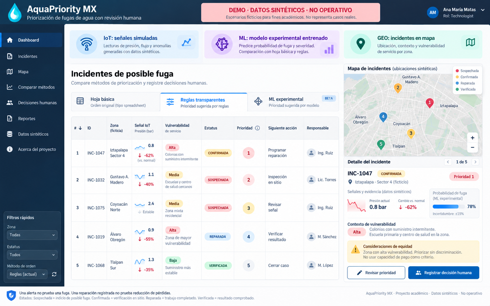
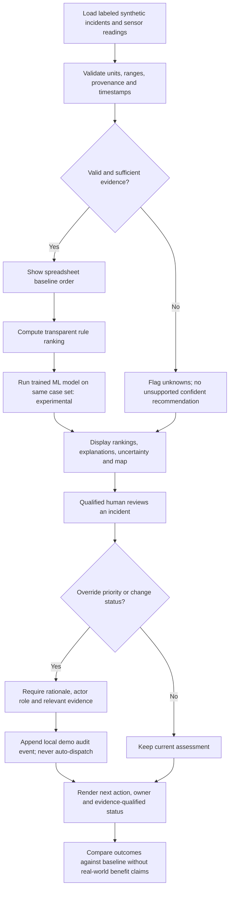
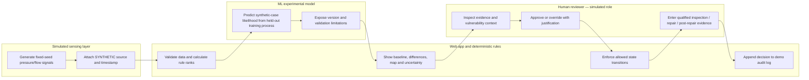

# AquaPriority MX — WEEK 11 BUSINESS BENDING PACKET

**Ana María Matas · TECHNOLOGIST · 22 October 2026**  
**Status:** Pre-code design packet. All incidents, locations, sensor readings, personnel and ML labels are **FICTIONAL / SYNTHETIC**. No live operational claims.

## 1. Source-of-truth alignment and problem in my words

**Team Blueprint (approved):** Team 3 chose **Loss Visibility**, 3–2, over Household Water. The primary vacuum is the gap between identifying a possible municipal network leak and completing a documented, verified repair. My individual declaration is to **compare basic spreadsheet tracking with rule-based repair prioritization on labeled hypothetical cases** (conditions 3 and 6). My dissent favoring Household Water remains visible, but this build follows the team outcome. The Blueprint's six conditions apply, especially **SHADOW CLAUSE — equity and anti-rationing**.

**Problem:** Detecting a possible leak does not fix it. Operators need to see which cases need human inspection next, why they are prioritized, who owns the next action, and whether a repair outcome has *actually* been verified. A prioritization dashboard can look authoritative while laundering uncertain data into unjustified decisions. This prototype deliberately exposes that uncertainty.

**Exact user:** A municipal water-operations triage coordinator or repair supervisor responsible for reviewing **fictional** possible leak cases in a Mexico City-style operational context; desktop browser, limited time, existing spreadsheet habits. Secondary actor: qualified field reviewer who updates inspection/repair evidence. This is a *synthetic persona*, not interviewed user research; do not describe it as validated field research.

**Precise decision:** Which incident should be **reviewed/inspected next**, and why? This prototype does **not** autonomously dispatch teams or decide excavation.

**Success by module close:** A publicly accessible free-hosted URL enables a visitor to (1) inspect a clearly labeled simulated sensor feed, (2) compare spreadsheet order, transparent rule order, and *trained* ML experimental order on the **same** case set, (3) see cases on an interactive fictional-location map, (4) open a case and record a human-reviewed priority override with explanation, (5) move a case through controlled status transitions without calling a recorded repair a verified outcome, and (6) download or inspect a transparent comparison/evidence summary. Tests pass, a real bug is logged/fixed/redeployed, 5+ genuine Git commits and 2+ deployments are evidenced. Success means a functional decision-support **demo**, not real repairs or water saved.

## 2. Blueprint conditions → build gates

| Blueprint condition | Non-negotiable application | Verification |
|---|---|---|
| 1. Actionable closure | Every incident displays owner, next action, status and resolution record (even if not resolved). | Missing fields tested; no false closures. |
| 2. Human authority | ML/rules may suggest only; dispatch, physical diagnosis, excavation and repair verification require qualified human review. | UI contains human confirmation and no autonomous-dispatch action. |
| 3. Incremental evidence | Baseline spreadsheet/manual order vs transparent rules; ML is *additional experimental benchmark*, never silently substituted. Report rank changes and test metrics without inventing time/cost/real loss savings. | Same frozen synthetic dataset + reproducible output. |
| **4. SHADOW: equity and anti-rationing** | Include service vulnerability in human-reviewed prioritization, never household ability to pay, punitive profiling or automated rationing. No automatic dispatch based on vulnerability. | Adversarial cases and manual review tests. |
| 5. Local feasibility | Existing spreadsheet workflow first; free web app, optional simulated sensing and geodata. No required physical sensor, real utility login or live internet feed. | App usable without hardware/secret keys; fallback list when map unavailable. |
| 6. Truth/auditability | `SUSPECTED`, `PHYSICALLY_CONFIRMED`, `REPAIRED`, `OUTCOME_VERIFIED` are distinct; include timestamps, assumptions, source, uncertainty and history of corrections. | Test forbidden transitions and labels. |

**Status semantics:** SUSPECTED = signal/report only. PHYSICALLY_CONFIRMED = qualified inspection recorded. REPAIRED = work recorded, not independently confirmed outcome. OUTCOME_VERIFIED = qualified post-repair evidence recorded. Any missing evidence keeps the less-strong label. Synthetic evidence still never implies a real repair.

## 3. Image-generated mockup (created BEFORE code)

**Mockup is a visual target, not proof of functioning software.** Build a smaller functional slice first; avoid assuming every illustration element must be implemented. Essential: compare modes, incident card, map, review and synthetic labels. Generated image may show visual example values that are NOT validated data; implemented labels and metrics must come from the tested dataset/model.

## 4. Mermaid flowchart — one user decision

## 5. Mermaid swimlane — responsibilities

## 6. Benchmark line — verified products and honest differentiation

**Best existing close-fit solution on Earth for the event-to-resolution process: TaKaDu Central Event Management**: integrates network measurements, analytics, event management, prioritization and repair verification for utility operations. Source: https://www.takadu.com/solution/ ; https://www.takadu.com/ . **Important dependency:** TaKaDu says its CEM fundamentally relies on DMAs and automatically collected flow data: https://www.takadu.com/faqs/ .

**Mine differs/localizes by:** It is a *low-cost academic, synthetic-data comparison tool* for Mexican operational decision-making, exposing a familiar spreadsheet baseline, explicit equity review, manual overrides and unverifiable outcomes rather than claiming full utility integration or proven superior detection.

**Additional benchmark:** FIDO Network Monitor combines IoT/acoustic sensing, AI leak analysis, GIS mapping and work-activity visibility: https://fido.tech/products/network-monitor . This demonstrates the dragon components already exist commercially; our implementation cannot claim novelty in IoT/ML/maps. No pilot outcomes are attributed to AquaPriority MX.

**Research boundary:** These are official vendor descriptions, not independent comparative proof or evidence that such systems are equally available to Mexican operators. No interview, procurement, cost benchmark or municipal technical data has been supplied.

## 7. Three-year long view (exactly three sentences)

In three years, AquaPriority MX could become an interoperable operational comparison and audit layer that works with municipal spreadsheets and permitted data feeds before requiring new equipment. Qualified teams could use it to record each step from suspected leak through independently evidenced repair outcomes while examining whether vulnerability-aware choices are fair and effective. Expansion would depend on real operator pilots demonstrating incremental value, reliable data access, accessible workflows, and safeguards against automated exclusion or false claims of saved water.

## 8. Scope cut — NOT building this week

No real municipal data, actual household profiles, citizen surveillance, paid priority, utility integrations, physical sensor deployment, independent leak localization, excavations, dispatch automation, repair certification, real water-savings estimates, LLM chatbot, real user accounts, cloud database, push alerts, hardware purchases, or polished analytics beyond the slice. All demo actor names and incident coordinates are fictitious. Maps show deliberately illustrative positions, **not real leak sites**. Do not represent illustrative coordinates as observed incident locations.

## 9. Architecture and DRAGON STACK — all three must be REAL features

| Layer | Free technical choice | Mandatory visible working behavior | Proof/test |
|---|---|---|---|
| UI and deployment | Next.js App Router + TypeScript + Vercel free tier | Comparison tabs, incident detail, validated override, status workflow | Playwright/smoke tests on deployed URL |
| **DRAGON 1 — IoT/sensing** | Timestamped deterministic **simulated** pressure/flow sensor feeds in local JSON or TypeScript generated by seeded script | Change simulated feed scenario or time window; case evidence and uncertainty update; explicit `SIMULATED SENSOR DATA` label | Unit test readings alter derived features; reject missing unit, timestamp, or impossible range |
| **DRAGON 2 — ML** | Python scikit-learn offline training script; serialize lightweight, inspectable Logistic Regression coefficient JSON; reproduce inference in TS (or use ONNX only if reliable and free) | **Actual fitted model** predicts synthetic-case leak likelihood; ML tab shows estimate, model version and non-validated label, compared with rule results | Training/test split with fixed seed, held-out metrics, artifact checksum, parity checks Python vs TS, baseline comparison; no invented performance |
| **DRAGON 3 — GEODATA** | Leaflet + OpenStreetMap tile layer where permitted, and local **fictional** GeoJSON for zone contexts | Interactive map click selects same incident as table; filter by fictional service-vulnerability zone; list fallback if tiles fail | Click map marker selects matching case; no geolocation/user location requested |
| Baseline | Spreadsheet-style FIFO/date ordering | Same incidents retained, sorted by date or existing-sheet index | Baseline comparison snapshot |
| Rule engine | Pure TypeScript deterministic scoring with documented weights and missing-data rules | Display reasons and vulnerability inputs, no automatic dispatch | Edge cases, ties, missing inputs and adverse cases |
| Data/storage | Built-in synthetic dataset; in-memory client state or browser-only optional local storage for demo, with reset | Human overrides and audit events visible; *not* a server-backed permanent audit record | Reset and reload behavior documented; no unsupported persistence guarantees |
| Security | No backend keys or accounts; static artifacts & strict TS validation | No personal data, all inputs range/length checked, HTML escaped by React, no unsafe dynamic script eval | Automated validation tests, repo secret scan, deploy env review |

**ML protocol (required, no fake AI):** `scripts/train_model.py` creates synthetic labeled examples with explicit assumptions; separate train/test *before* fitting; fixed seed; save `model_coefficients.json` and actual measured metrics to `model_card.md`; load coefficients and apply sigmoid in application code; test parity to Python fixture predictions with tolerances. Label UI `ML EXPERIMENTAL — TRAINED ON SYNTHETIC DATA; NOT VALIDATED ON REAL LEAKS`. Distinguish synthetic ground truth from sensor evidence. A simulation-generated correlation is not field performance. If model training cannot execute, show `ML UNAVAILABLE`, **never silently substitute rules or hard-coded pseudo-predictions.**

**Sensor protocol:** `seed`, `timestamp`, `sensorId`, `pressureBar`, `flowLpm`, `qualityFlag`, `source=SIMULATED`, `units` fields. A reading alone yields *possible anomaly*, never proof of physical leak. Reject physically impossible readings and show degraded confidence for missing/inconsistent observations.

**Geodata protocol:** Local synthetic incident lat/lon positions and zone polygons are visual examples only; do not draw real assets or imply actual utility coverage. A basemap may require connectivity; show list when unavailable. Do not use household income as a scoring proxy.

## 10. Comparison protocol and decision guardrails

- Freeze a documented synthetic evaluation set before choosing preferred rankings. Use the *same incidents* for baseline, rules and ML; show differences in ranks and reasons.
- Baseline: insertion order or report timestamp, as a minimal spreadsheet analogue; label that this is a proxy, not an observed municipal workflow.
- Rule: deterministic score uses available severity signal, elapsed time, feasibility and **service vulnerability review**. Disclose exact weights. Missing essential data triggers `REVIEW REQUIRED`, never a confident top-priority assertion.
- ML: show an experimental predicted label or score, model limitations, and side-by-side order; it **cannot** approve actual actions or independently verify events.
- Equity audit: compare ranking behavior for fictional vulnerable and non-vulnerable neighborhoods with similar incident evidence. Any recommended priority must be reviewable and overrideable. Never include ability to pay or individual household profiles.
- Metrics for this demo: rank changes, top-k overlap, synthetic-label precision/recall where appropriate, missing-data abstentions, human override count, transition compliance. **Cannot measure** real repair delays, real savings, cost savings or verified reduction with this dataset.

## 11. Functional acceptance criteria (no code until Packet approval)

1. Home clearly states `DEMO — SYNTHETIC DATA — NOT OPERATIONAL` and labels IoT source & ML status throughout.
2. At least eight reproducible synthetic incidents with owner, next action, evidence timestamp, source, and status; no real identities.
3. Three independently computed views: `Spreadsheet baseline`, `Transparent rules`, `Trained ML (experimental)`; visible rank changes and justifications.
4. Altering a simulated pressure/flow scenario changes an input feature and recomputes affected views as designed, with no claim of confirmed leaks.
5. Clicking a fictional map marker opens the corresponding incident; non-map list works without tiles.
6. Reviewer can override suggested priority only by recording a justification, and can review before any consequential action.
7. Only permitted transitions; `REPAIRED` never automatically changes to `OUTCOME_VERIFIED`; mock post-repair evidence and role confirmation needed for status update.
8. At least one missing/contradictory evidence case abstains from a confident suggestion.
9. Same synthetic data drive both rankings and status/detail views; state and correction log coherent within documented session scope.
10. Real trained model artifact, training script, holdout metrics, inference parity test and explicit synthetic-data warning are present and verified.
11. Security floor checked *before* first deployment; no secrets, stored personal data, or real demo identities.
12. At least 5 meaningful commits and 2 deploys are documented with hashes/URLs; actual live URL and GitHub link verified before submission.

## 12. Mechanical tests, required bug-fix-redeploy, and Persona Test

**Mechanical pass:** Vitest units: parse/units/ranges, simulator determinism and update, sorting tie-breaking, missing-data abstention, score weighting, equity exclusion, allowed status state machine, audit event append; ML Python training reproducibility and held-out metrics, TS parity; map marker ↔ row selection; browser smoke tests for mode changes, review and label persistence. Record baseline results. Find **at least one genuine bug**, log repro, screenshot, cause, failed test, fix commit, passing rerun and **redeploy**. Never invent a bug just to satisfy the rubric.

**Persona pass (fresh chat; synthetic):** "You are Elena, 46, coordinator in a municipal water-operations team. You use spreadsheets every day, work under time pressure, have little patience for complex dashboards, and must avoid incorrectly reporting a suspected leak as repaired. You know field staff must verify suspected incidents; you do not treat ML as authority. Try to choose the next case for inspection from screen screenshots *in order*. Narrate hesitation, misunderstandings and where you would give up. Do not assume buttons work if not visible." Take actual screenshots of each implemented screen, paste sequentially, log precise observed confusions and severity, fix the worst confirmed issue, rerun the affected path; save `PERSONA_AnaMariaMatas.pdf` with before/after evidence. This persona is simulated, **not genuine field research**.

**Test log template:** `Test ID | version/commit | input | expected | observed | pass/fail | screenshot | fix link | redeploy link`.

## 13. Build plan, commits, deploys and Session Close

**Before code:** save and commit `docs/PACKET.md` + mockup and Mermaid code, source notes, `docs/DECISIONS.md` initial constraints. Then ask Codex for an implementation plan **derived from this exact packet** with per-feature acceptance criteria and no scope inflation; evaluate it before code.

**Proposed minimum commits (not yet completed):**
1. `docs: pre-code packet, mockup, diagrams, decisions`;
2. `feat: validated synthetic feed and incident data`;
3. `feat: spreadsheet and transparent rule comparison`;
4. `feat: offline-trained ML artifact and reproducible inference`;
5. `feat: fictional GeoJSON map and human review state workflow`;
6. `test: regression and genuine bug fix`;
7. `docs: persona findings, decision log and security checklist`.

**Deployment 1:** initial usable demo after core comparison and security review. **Deployment 2:** after genuine test-fix cycle. Each must have a real Vercel deployment URL and timestamp; no invented links. Submit only a reachable, tested production URL. Keep free-tier-only services.

**Every session close:** Update `docs/DECISIONS.md` with decisions, unresolved blockers, security/test status and **tomorrow's first move**; commit and push; note the resulting hash and deployed state. Preserve **the entire agent development back-and-forth** (prompts, replies, troubleshooting, commands, tests and actual outputs) as raw chronological text to generate `BUILDCHAT_AnaMariaMatas.pdf` without fabricated history or missing early turns. Git log alone is not the transcript.

## 14. Security floor — verified pre-build design, execution still pending

- No secrets in source, generated artifacts or GitHub; env vars on Vercel only *if* any become necessary. Initial slice needs none. Scan repository and commit history before sharing.
- No personal data stored; no auth/database planned. **If scope adds persisted personal/user data, stop and add Supabase Google Auth + RLS and test isolation before deployment.** Do not claim compliance unless implemented and tested.
- Validate all case fields, ranks, free-text reasons (max length), status transitions, model input feature ranges, geographic coordinates and JSON decoding. No raw unvalidated payloads to model/UI.
- No real personal data, real homes, actual city incident locations or unverifiable municipal outcomes; use synthetic names, identifiers and readings on screen.
- ML training has no user secrets, no external data calls; model load failures fail closed and disclose unavailable state.

## 15. Submission checklist — all future deliverables, not yet produced

- Verified **Live URL + GitHub link** (mandatory; no live URL caps at 3/10).
- `DEMO_AnaMariaMatas.mp4` (3-minute live user walkthrough + 30-second change-of-mind reflection).
- `PACKET_AnaMariaMatas.pdf` (export of this pre-code packet with generated mockup/diagram sources).
- `PERSONA_AnaMariaMatas.pdf` (actual ordered screenshots and confusion → fix evidence).
- `BUILDCHAT_AnaMariaMatas.pdf` (**full** chronological development conversation; never a summary disguised as transcript).

**Current verified progress:** Blueprint + individual brief reviewed; benchmark vendor pages researched; genuine image-generated mockup produced; Packet authored. **NOT DONE:** code, running ML model, tests, commits, deployments, live URL, persona interaction, demo video or complete development transcript. These must be actually performed and evidenced.
